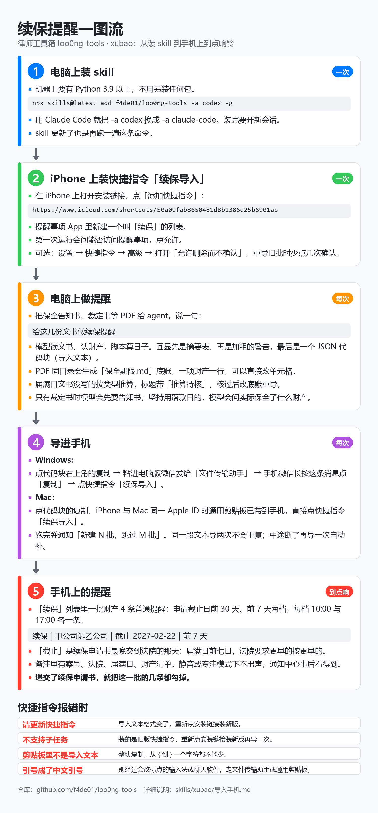

# 律师工具箱（loo0ng-tools）

不碰案件图的律师实用工具，以 skill 形态交付，Codex 为主、Claude Code 同样可用。读写案件图的工作归律师工作台 [loo0ng-skills](https://github.com/f4de01/loo0ng-skills)。

## 工具

| skill | 做什么 |
| --- | --- |
| [xubao](skills/xubao/SKILL.md) | 续保提醒：读保全告知书、裁定书等 PDF，把每项财产的保全期限记进同目录的 `保全期限.md`，算出续保申请截止日（届满七日前，法院要求更早的取更早），生成导入 iPhone 提醒事项的文本 |

## 安装与使用

一图看完从装 skill 到手机上响铃的全过程：[docs/一图流.png](docs/一图流.png)。



### 电脑上装 skill（一次）

走 skills.sh，安装源须是公开仓库：

```bash
npx skills@latest add f4de01/loo0ng-tools -a codex -g
```

用 Claude Code 就把 `-a codex` 换成 `-a claude-code`。`-g` 装到用户目录，在哪个目录开会话都能用；不带它只装进当前目录。装完要开新会话才认得。机器上要有 Python 3.9 以上，不用另装任何包。**skill 更新了也是再跑一遍这条命令**，然后开新会话。

### iPhone 上装快捷指令（一次）

在 iPhone 上打开 <https://www.icloud.com/shortcuts/50a09fab8650481d8b1386d25b6901ab>，点「添加快捷指令」；提醒事项里新建一个叫「续保」的列表。签名好的快捷指令文件也在 [dist/](dist/)，用「文件」打开同样能装。快捷指令怎么生成、改了怎么重发见 [docs/快捷指令搭建.md](docs/快捷指令搭建.md)。

### 每次怎么用

给出 PDF，说一句「给这几份文书做续保提醒」，agent 会自己调用 skill；想点名就在 Codex 里写 `$xubao`，Claude Code 里输 `/xubao`。回显末尾的 JSON 代码块整块复制到 iPhone 上，点快捷指令「续保导入」。「续保」列表里一批财产 4 条提醒：申请截止日前 30 天、前 7 天两档，每档 10:00 与 17:00 各一条；递交续保申请书后把这一批都勾掉。导入的每一步与报错怎么办见 [导入手机.md](skills/xubao/导入手机.md)。

## 开发

设计起点见 [docs/handoff.md](docs/handoff.md)，词汇以 [CONTEXT.md](CONTEXT.md) 为准，决策记在 [docs/adr/](docs/adr/)，给 agent 的规矩在 [AGENTS.md](AGENTS.md)。

克隆后先装隐私钩子（扫暂存改动与 commit message，拦案号、案件目录路径、手机号、身份证号、统一社会信用代码）：

```bash
git config core.hooksPath .githooks
python scripts/privacy-check.py --all     # 全仓基线
```

改了文本文件、提交之前：

```bash
bash scripts/check-text.sh .
python -m unittest discover -s tests/xubao -p "test_*.py"
python -m unittest discover -s tests/skills -p "test_*.py"
python -m unittest discover -s tests/privacy-check -p "test_*.py"
python -m unittest discover -s tests/check-text -p "test_*.py"
```

测试只用合成件。`tests/xubao/fixtures/` 里的两份假告知书（文字版、扫描版）由同目录的 `make_fixtures.py` 生成，那个脚本要 PyMuPDF，只在开发机上跑；测试本身只用标准库。

## 许可

代码与文档按 [MIT](LICENSE) 授权。合成测试 PDF 里嵌入的字体子集不在其内，范围说明在 `LICENSE` 末尾。
